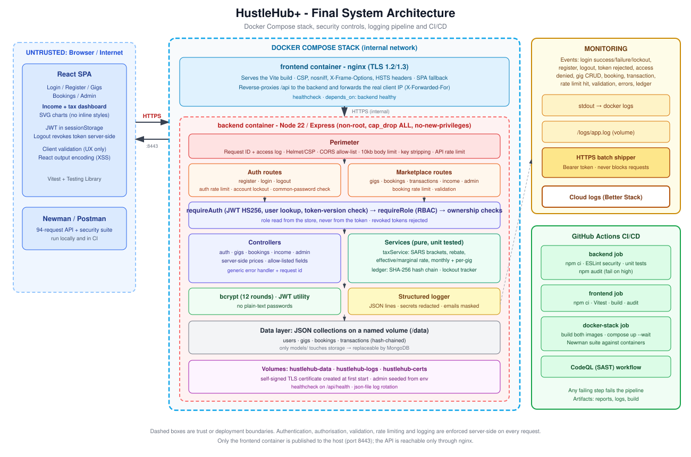

# HustleHub+ - Secure Freelance Marketplace

HustleHub+ lets **freelancers** advertise services ("gigs") and **clients** browse and book them. Every
booking creates a transaction, and freelancers get an income dashboard with an estimated South African
income-tax figure. The system handles credentials, financial records and income data, so security is a
design requirement throughout, and this final version adds the DevSecOps practices (CI/CD, static
analysis, containers) and monitoring (structured and cloud logging) needed to run it responsibly.

| Part | Delivered |
|---|---|
| 1 | Secure auth foundation: bcrypt, JWT, HTTPS, validation, controlled errors, Postman tests |
| 2 | Marketplace (gigs, bookings, transactions), RBAC, rate limiting, Helmet + CSP, React frontend, Newman, frontend tests |
| **Final (this version)** | **SARS tax estimation + income dashboard, GitHub Actions CI/CD, static analysis, Docker Compose, structured + cloud logging, five extra security features, security review** |



## Contents
1. [What is new in the final version](#1-what-is-new-in-the-final-version)
2. [Features and roles](#2-features-and-roles)
3. [Tax estimation and income dashboard](#3-tax-estimation-and-income-dashboard)
4. [Project structure](#4-project-structure)
5. [Setup and running](#5-setup-and-running)
6. [API summary](#6-api-summary)
7. [Security implementation](#7-security-implementation)
8. [Additional security features](#8-additional-security-features)
9. [Final security review](#9-final-security-review)
10. [Logging and monitoring](#10-logging-and-monitoring)
11. [Testing](#11-testing)
12. [CI/CD pipeline](#12-cicd-pipeline)
13. [Static code analysis](#13-static-code-analysis)
14. [Docker and Docker Compose](#14-docker-and-docker-compose)
15. [Demonstration video](#15-demonstration-video)
16. [Git workflow](#16-git-workflow)
17. [Limitations and future work](#17-limitations-and-future-work)
18. [Troubleshooting](#18-troubleshooting)

---

## 1. What is new in the final version

| Area | Change |
|---|---|
| Tax | Replaced the flat 15% placeholder with a **progressive SARS tax calculation** (brackets + primary rebate), per tax year, with unit tests against SARS's published figures |
| Dashboard | New freelancer income page: summary cards, monthly income bar chart, tax-vs-net donut, bracket-by-bracket table, earnings by gig, insights, tax-year selector, in-app explanation of the method |
| CI/CD | GitHub Actions: backend (lint, unit tests, audit), frontend (tests, build, audit), Docker stack (build, run, Newman) and CodeQL |
| Static analysis | ESLint with `eslint-plugin-security` (zero warnings allowed) and GitHub CodeQL |
| Docker | Backend and frontend Dockerfiles, `docker-compose.yml`, HTTPS in both containers, health checks, non-root backend |
| Logging | Structured JSON logs for logins, bookings, transactions, errors and more, written to console, file and a **cloud platform** (Better Stack over HTTPS) |
| Security features | Per-account lockout, token revocation on logout, tamper-evident transaction ledger, common-password blocklist, request correlation IDs |
| Tests | 55 backend unit tests, 94-request Newman suite (135 assertions), 67 frontend tests |

---

## 2. Features and roles

**Clients** browse and search gigs, book a gig with optional notes (simulated payment), and see their bookings.

**Freelancers** create, edit (including hide/show) and delete their own gigs, see bookings on their gigs, and use the
income and tax dashboard.

**Admins** list users (never with password hashes), view all transactions, delete any gig, and run the
**ledger integrity check**. Admins cannot be created through the API; they are seeded with `npm run seed:admin`.

Every booking creates a booking and a linked, hash-sealed **transaction** (client, freelancer, gig, amount,
currency, status). The amount always comes from the gig on the server, so a client cannot choose the price.

| Capability | Client | Freelancer | Admin |
|---|:--:|:--:|:--:|
| Browse gigs | yes | yes | yes |
| Create / edit own gigs | no | yes | no |
| Delete a gig | no | own only | any |
| Book a gig | yes | no | no |
| View own bookings / payments | yes | yes | no |
| Income and tax dashboard | no | yes (own) | no |
| List users, all transactions, verify ledger | no | no | yes |

---

## 3. Tax estimation and income dashboard

### How the estimate is calculated
The logic lives in `src/services/taxService.js` (pure functions, unit tested) and the tables in
`src/config/taxTables.js`. All money is handled as **integer cents** to avoid floating-point errors.

1. **Gross income** = the sum of the freelancer's *completed* transactions in the chosen **tax year**
   (1 March to the end of February, South African time, UTC+2).
2. **Taxable income** = gross income. Expenses and deductions are not modelled.
3. **Normal tax** = progressive SARS brackets applied slice by slice (each slice is taxed only at its own rate).
4. **Tax payable** = normal tax minus the **primary rebate**, never below zero. Income below the *tax
   threshold* (rebate / 18%) therefore pays nothing.
5. **Effective rate** = tax / income. **Marginal rate** = the rate on the last rand earned.

### Tables used (SARS, 2026/27 tax year, 1 March 2026 to 28 February 2027)

| Taxable income (R) | Tax |
|---|---|
| 0 - 245,100 | 18% of taxable income |
| 245,101 - 383,100 | 44,118 + 26% above 245,100 |
| 383,101 - 530,200 | 79,998 + 31% above 383,100 |
| 530,201 - 695,800 | 125,599 + 36% above 530,200 |
| 695,801 - 887,000 | 185,215 + 39% above 695,800 |
| 887,001 - 1,878,600 | 259,783 + 41% above 887,000 |
| 1,878,601 and above | 666,339 + 45% above 1,878,600 |

Primary rebate: **R17,820** (tax threshold R99,000). The 2025/26 table (rebate R17,235, threshold R95,750) is
also included so older transactions are calculated correctly. The base amounts above are **derived in code**
from the brackets and rates and checked by unit tests against the published SARS figures.

### Worked examples
* **R150,000 earned** (2026/27): 18% x 150,000 = R27,000, minus rebate R17,820 = **R9,180 tax** (effective 6.12%, marginal 18%). The dashboard also shows R95,100 until the 26% bracket.
* **R500,000 earned**: 79,998 + 31% x (500,000 - 383,100) = R116,237, minus R17,820 = **R98,417 tax** (effective 19.68%, marginal 31%).
* **R90,000 earned**: below the R99,000 threshold, so **R0 tax**.

### Assumptions and limits
Under 65 (only the primary rebate), the platform is the only income, no expenses/retirement/medical credits or
provisional-tax payments, and the SARS tables are applied as published. It is an **illustrative estimate, not tax
advice**. Tables must be updated after each February Budget (add an entry to `taxTables.js`).

### Frontend dashboard (`client/src/pages/IncomePage.jsx`)
* Summary cards: gross income, estimated tax, net after tax, effective and marginal rate
* Insight box: how far you are from the threshold or the next bracket
* **Monthly income** bar chart across the tax year and a **tax vs net** donut (hand-written SVG, no chart library, so the strict CSP stays intact)
* **Bracket-by-bracket table** showing exactly how the tax was built, plus an expandable explanation and the assumptions (served by the API so UI and docs cannot drift apart)
* Earnings by gig, tax-year selector, and a transactions list

---

## 4. Project structure

```
hustlehub/
├── server.js                        # HTTPS entry point, graceful shutdown, crash logging
├── Dockerfile, docker-compose.yml   # backend image + the whole stack
├── docker/backend-entrypoint.sh     # creates the TLS cert, seeds the admin, starts the API
├── eslint.config.mjs                # static analysis (ESLint + security plugin)
├── .github/workflows/ci.yml         # CI/CD pipeline
├── .github/workflows/codeql.yml     # CodeQL static analysis
├── .github/dependabot.yml           # automatic dependency update PRs
├── docs/                            # DEMO_SCRIPT.md, EVIDENCE.md, evidence/ (screenshots)
├── postman/HustleHub.postman_collection.json
├── scripts/                         # seedAdmin, seedDemo, rateLimitCheck
├── tests/unit/                      # backend unit tests (node:test)
├── src/
│   ├── app.js, constants.js
│   ├── config/                      # env.js, taxTables.js
│   ├── controllers/                 # auth, gig, booking, transaction (+income), admin
│   ├── middleware/                  # authMiddleware, rateLimiters, sanitizeRequest, validateRequest,
│   │                                # errorHandler, requestContext (request id + access log)
│   ├── models/                      # userStore, jsonStore, collections
│   ├── routes/ validators/ utils/   # utils: jwt, passwords, sanitize, logger, logShipper, commonPasswords
│   └── services/                    # taxService, ledger, loginAttempts
└── client/
    ├── Dockerfile, docker/          # nginx (HTTPS, CSP headers, /api proxy) + cert script
    └── src/                         # api, context, components (+ charts/), pages, utils, tests
```

---

## 5. Setup and running

Requires **Node 18+** (Node 22 recommended) and, for the container stack, **Docker with Compose v2**.

### 5.1 Local development
```bash
npm install
cp .env.example .env                 # then set JWT_SECRET (a generator command is in the file)
# create the local certificate (Git Bash on Windows: use "//CN=localhost"):
openssl req -x509 -newkey rsa:2048 -nodes -keyout certs/key.pem -out certs/cert.pem -days 365 -subj "/CN=localhost"
npm run seed:admin                   # admin from ADMIN_EMAIL / ADMIN_PASSWORD
npm run dev                          # API on https://localhost:5443

npm run client:install
npm --prefix client run dev          # app on http://localhost:5173 (proxies /api)
```
Optional demo data for the dashboard (one freelancer with bookings across the tax year):
```bash
npm run seed:demo    # thandi@demo.hustlehub.local, sipho@demo.hustlehub.local / DemoPass123
```
Production-style (strict CSP served by Express): `npm run client:build`, then `npm start` and open `https://localhost:5443`.

### 5.2 Docker Compose (recommended for the demonstration)
```bash
cp .env.example .env                 # set JWT_SECRET and ADMIN_PASSWORD (both are required)
docker compose up -d --build --wait  # builds both images, starts them, waits until healthy
```
Open **https://localhost:8443** (accept the self-signed certificate warning). Log in as the admin with
`ADMIN_EMAIL` / `ADMIN_PASSWORD` from `.env`. See [section 14](#14-docker-and-docker-compose).

---

## 6. API summary

| Method | Endpoint | Who | Notes |
|---|---|---|---|
| POST | `/api/auth/register` | public | role `client` or `freelancer`; rate limited; common passwords rejected |
| POST | `/api/auth/login` | public | JWT; rate limited; per-account lockout |
| POST | `/api/auth/logout` | authenticated | revokes **all** tokens for the account |
| GET | `/api/profile` | authenticated | |
| GET | `/api/gigs`, `/api/gigs/:id`, `/api/gigs/categories` | authenticated | `?q=` and `?category=` |
| GET | `/api/gigs/mine` | freelancer | |
| POST / PUT / DELETE | `/api/gigs`, `/api/gigs/:id` | freelancer (owner); delete also admin | ownership enforced |
| POST | `/api/bookings` | client | creates booking + sealed transaction; rate limited |
| GET | `/api/bookings/mine`, `/api/bookings/:id` | parties (or admin for `:id`) | |
| GET | `/api/transactions/mine` | client, freelancer | |
| GET | `/api/income?taxYear=2026` | freelancer | tax estimate + chart data for one tax year |
| GET | `/api/admin/users`, `/api/admin/transactions` | admin | |
| GET | `/api/admin/ledger/verify` | admin | re-computes the transaction hash chain |

### Role matrix

| Capability | Client | Freelancer | Admin |
|---|:--:|:--:|:--:|
| Browse gigs | yes | yes | yes |
| Create / edit own gigs | no | yes | no |
| Delete a gig | no | own only | any |
| Book a gig | yes | no | no |
| View own bookings / transactions | yes | yes | no (uses admin views) |
| View income | no | yes (own) | no |
| List users / all transactions | no | no | yes |

---

## 7. Security implementation

| Control | Implementation |
|---|---|
| Password storage | bcrypt, 12 rounds, per-hash salt; hashes never returned or logged |
| Authentication | JWT HS256 (algorithm pinned), 1 hour expiry, validated on **every** protected request |
| Authorisation | `requireRole` per endpoint (runs before validation) plus ownership checks; role read from the user store, not the token |
| Input validation | `express-validator`: type checks first, then length/format/range; UUID ids; category allow-list |
| Sanitisation | HTML stripped from free text; `$`-keys, dotted keys and `__proto__` removed from bodies/queries; allow-listed fields (no mass assignment) |
| Rate limiting | auth 50 / 15 min, booking 10 / 10 min, general API 300 / 15 min, all returning `429` + `Retry-After` and logged |
| Security headers | Helmet with a strict CSP (`default-src 'self'`, no inline script/style, `frame-ancestors 'none'`, `object-src 'none'`); nginx sets the same policy for static files; HSTS in production |
| Transport | HTTPS everywhere: browser to nginx, and nginx to the API (TLS 1.2/1.3) |
| Error handling | one handler: generic messages, request id for support, stack traces only in logs; malformed JSON and oversized bodies mapped to safe messages |
| CORS | allow-list from `CLIENT_ORIGIN` |
| Business-logic integrity | server-side prices; transactions created in the same request as bookings; hash-chained ledger |
| Containers | non-root backend, `cap_drop: ALL`, `no-new-privileges`, only the frontend port published, secrets from `.env` (never baked into images) |
| Supply chain | `npm audit` gate in CI, Dependabot updates, lockfiles and `npm ci` |

---

## 8. Additional security features

Five features beyond the minimum requirements. All are functional, integrated, unit tested, and covered by the Newman suite.

### 8.1 Per-account login lockout (`src/services/loginAttempts.js`)
After **5 failed logins** for the same e-mail within 15 minutes, that account is locked for 15 minutes: even the
correct password is refused with `429` and a `Retry-After` header. It complements IP rate limiting by stopping a
*distributed* guessing attack against one account. Failures are tracked for **unknown e-mails too**, so the response
never reveals whether an account exists (no enumeration). State is capped in memory so it cannot be used to exhaust
memory. Trade-off: an attacker can briefly lock a known user out; the lock expires and IP limits slow repetition.
*Demo:* five wrong passwords, then the right one.

### 8.2 Server-side token revocation (`POST /api/auth/logout`)
JWTs are normally impossible to cancel before they expire. Each user has a `tokenVersion` that is embedded in every
token (`ver`); logout increments it, so **every earlier token for that account dies immediately** and
`requireAuth` rejects it. The React app calls this on logout. *Demo:* log in, copy the token, log out, call
`/api/profile` with the copied token and get `401`.

### 8.3 Tamper-evident transaction ledger (`src/services/ledger.js`)
Each transaction stores `prevHash` and `hash` (SHA-256 over its financial fields and the previous hash). Editing an
amount or user, deleting or reordering a record breaks the chain, and `GET /api/admin/ledger/verify` (button on the
Admin page) reports exactly where. Comparisons use `crypto.timingSafeEqual`. Every new hash is also written to the
**cloud log** (`transaction.created`, field `ledgerHash`), so rewriting the whole file would also require rewriting the
remote logs. Limitation: deleting the very last record is only detectable by comparing with the logged hash.
*Demo:* book a gig, edit an amount in `src/data/transactions.json`, press **Verify ledger**.

### 8.4 Common-password blocklist (`src/utils/commonPasswords.js`)
Complexity rules still accept `Password123`. Registration now rejects passwords that are on a list of very common
choices, with a clear message.

### 8.5 Request correlation IDs and security event logging
Every request gets a UUID (`X-Request-Id` header and in every log line). Error responses include it, so a user can
quote it and an administrator can find the exact log entry. See [section 10](#10-logging-and-monitoring).

---

## 9. Final security review

How the system addresses the common threats (OWASP Top 10 style):

| Threat | How it is addressed | Where / how verified |
|---|---|---|
| **Injection (NoSQL/operator, command, prototype pollution)** | No SQL and no shell calls. Every field is type-checked before use, so `{"$ne": null}` is never treated as a value; `$`-keys, dotted keys and `__proto__` are stripped; ids must be UUIDs; allow-listed fields only | `sanitizeRequest.js`, `*Validators.js`; unit tests; Newman "operator injection rejected" |
| **Cross-site scripting** | HTML tags and control characters stripped on input; React escapes all output and never uses `dangerouslySetInnerHTML`; strict CSP (no inline scripts, `script-src 'self'`) blocks injected scripts; `X-Content-Type-Options: nosniff` | `sanitize.js`; `GigCard` XSS test; Newman "HTML stripped"; CSP header test |
| **Broken authentication** | bcrypt hashing, common-password blocklist, JWT with pinned algorithm and expiry, identical error for unknown e-mail and wrong password, IP rate limiting, **per-account lockout**, **server-side revocation**, `alg:none` and tampered tokens rejected | Newman auth, lockout, revocation and token tests |
| **Broken access control / IDOR** | Authentication on all non-auth routes, RBAC per endpoint, ownership checks on gigs, booking visibility limited to the two parties or admin, identity always taken from the JWT never the body, role loaded from the store | Newman 403 tests (other freelancer, wrong role, admin-only routes) |
| **Cryptographic failures / data exposure** | HTTPS everywhere, bcrypt, secrets only in environment variables, `passwordHash` and `tokenVersion` stripped from responses, logs redact secrets and mask e-mails | `toPublicUser`, `logger.js`; unit tests |
| **Insecure design (business logic)** | Price read server-side, booking and transaction created together (rolled back on failure), hash-chained ledger, rate-limited booking endpoint | `bookingController`, `ledger.js` |
| **Security misconfiguration** | Helmet + CSP, `X-Powered-By` removed, CORS allow-list, non-root containers with dropped capabilities, health checks, HSTS in production, no stack traces in responses | Newman header test; Compose file |
| **Vulnerable components** | `npm audit` fails CI on high/critical findings, Dependabot, lockfiles, CodeQL | CI workflow |
| **Logging and monitoring failures** | Security events (failed logins, lockouts, denied access, rate limits, tampering) are logged with request ids and shipped to a cloud platform | [Section 10](#10-logging-and-monitoring) |
| **CSRF** | Authentication uses a Bearer token in a header (not an automatically sent cookie), so cross-site requests cannot attach it; CORS is restricted | Design decision |
| **Denial of service / brute force** | Body size limit (10 kb), three rate limiters, lockout | Newman 413 test; `npm run test:ratelimit` |
| **SSRF** | The server makes no requests from user input; the only outbound call is the optional HTTPS log shipper to a configured URL (non-HTTPS URLs are refused) | `logShipper.js` |

**Residual risks (honest assessment):** the JWT is kept in `sessionStorage` (httpOnly cookies + CSRF tokens would be
stronger against XSS, mitigated here by the strict CSP and output encoding); storage is JSON files (single process, no
transactions); rate-limit and lockout state is in memory (reset on restart, per instance); the self-signed certificate
must be replaced by a CA-issued certificate in production; there is no multi-factor authentication or password reset.

---

## 10. Logging and monitoring

### What is logged
Logs are **structured JSON lines** (`src/utils/logger.js`) written to three places: the console (`docker logs`), a
file (`logs/app.log`, or the `hustlehub-logs` volume), and a **cloud logging platform** over HTTPS. Every line has `dt`
(timestamp), `level`, `event`, `message`, `service`, `env`, and request context (`requestId`, `ip`, `method`, `path`,
`userId`).

| Event | Level | Why it matters |
|---|---|---|
| `auth.login.success` | info | Audit trail of who accessed the system and when |
| `auth.login.failure` | warn | Detects password guessing and credential stuffing (reason: `bad_password` / `unknown_email`, masked e-mail) |
| `auth.login.lockout` / `auth.login.locked` | warn | An account is under attack; a lock was triggered or a locked account was tried |
| `auth.register.success` / `auth.register.duplicate` | info / warn | New accounts and enumeration attempts |
| `auth.logout` | info | Session revocation |
| `auth.token.rejected` | warn | Missing, forged, expired or revoked tokens (reason recorded) |
| `access.denied` | warn | Role violations and attempts to touch other users' gigs/bookings (possible IDOR probing) |
| `rate_limit.exceeded` | warn | Which limiter, from which IP: automated abuse |
| `validation.failed` | warn | Field names only (never values): malformed or malicious input |
| `gig.created` / `gig.updated` / `gig.deleted` | info | Changes to marketplace data |
| `booking.created` | info | Business events |
| `transaction.created` | info | Financial record created, with `ledgerHash` (an external anchor for integrity) |
| `income.viewed` | info | Access to financial data |
| `admin.users.listed`, `admin.ledger.verified` | info | Privileged actions |
| `ledger.tamper_detected` | **error** | Financial data was modified outside the application |
| `error.unhandled` | **error** | Unexpected failures, with stack trace and request id (never sent to the client) |
| `http.request` | info / warn / error | One access-log line per request with status and duration |
| `server.started`, `server.stopping`, `process.*` | info / error | Lifecycle and crashes |

**Why this matters:** logs are how an attack or fault is *noticed*. Failed-login and lockout events reveal guessing
attacks; `access.denied` and `auth.token.rejected` reveal probing; `transaction.created` plus the ledger hash give
a financial audit trail that survives tampering with the data file; `error.unhandled` with a request id lets
operators fix problems without ever exposing internals to users.

**Privacy and safety:** passwords, tokens, `Authorization` headers and hashes are **redacted**; e-mail addresses
are **masked** (`j***@example.com`); validation logs record field *names*, not values; log injection is avoided because
entries are JSON-encoded.

---

## 11. Testing

| Layer | Tool | Command | Covers |
|---|---|---|---|
| Backend unit | Node test runner | `npm run test:unit` | **55 tests**: tax brackets/rebates/tax years/summaries, ledger tamper detection, logger redaction and shipper, lockout tracker, sanitisers, password blocklist, storage |
| API + security | Postman collection run by **Newman** | `npm run test:api` | **94 requests**: auth, lockout, revocation, gig CRUD, ownership, RBAC, bookings and transactions, income/tax data, admin ledger verification, headers, injection, `alg:none`, tampered JWT, oversized body |
| Frontend | Vitest + Testing Library | `npm run test:client` | **67 tests**: forms and validation (incl. common-password rule), login lockout message, role-based UI, XSS-safe rendering, route protection, booking flow and receipts, payments, logout revocation, charts, income dashboard, ledger check |
| Rate limiting | script | `npm run test:ratelimit` | Sends logins with different e-mails until `429` |

Newman needs the API running and the admin seeded (the Docker stack seeds it itself). One run uses about 25 of the 50
allowed auth requests per 15 minutes; restart the server between runs or raise `AUTH_RATE_LIMIT_MAX`. Against the
containers: `npm run test:api:docker` (uses `https://localhost:8443/api`). HTML reports are written to `reports/`.

---

## 12. CI/CD pipeline

Defined in `.github/workflows/ci.yml` and `codeql.yml`. It runs **automatically** on every push to `main`, `develop`,
`feature/**` and `fix/**`, on pull requests, and on demand.

| Job | Steps |
|---|---|
| **backend** | checkout, Node 22, `npm ci`, **ESLint + security plugin (0 warnings allowed)**, **backend unit tests**, **`npm audit` (fail on high/critical)**, upload report |
| **frontend** | `npm ci`, **Vitest**, **production build**, `npm audit`, upload build |
| **docker-stack** (needs the two above) | **build both images**, `docker compose up --wait` (**both containers must become healthy**), run the **Newman suite against the running containers**, upload report and container logs, tear down |
| **ci-passed** | Green only if every job above passed (use as the required status check) |
| **CodeQL** (separate workflow) | GitHub semantic analysis of the Node and React code with `security-extended` queries; also weekly |

**The pipeline fails when checks fail:** no step uses `continue-on-error`, so a failing test, a lint warning, a
high-severity dependency vulnerability, an image that does not build, an unhealthy container or a failing API/security
test turns the run red and `ci-passed` does not run. To protect `main`, enable *Settings -> Branches -> Require status
checks* with `ci-passed` (and the CodeQL check). CodeQL reports findings in the Security tab; requiring the check
makes new findings block merges.

**Demonstrating a failure (for the evidence):** on a branch, change an expected value in `tests/unit/tax.test.js` (or add an
unused variable), push, and screenshot the red run; revert and screenshot the green one.

---

## 13. Static code analysis

Tools: **ESLint 9 with `eslint-plugin-security`** (backend, in CI and locally) and **GitHub CodeQL** (whole repo, including
the React code). `npm audit` covers known-vulnerable dependencies.

```bash
npm run lint           # prints findings, fails on any warning
npm run lint:report    # also writes reports/eslint-report.txt (uploaded as a CI artifact)
```

### What the results mean
* An empty ESLint run (exit code 0, no output) means no rule from `eslint:recommended` or the security plugin fired, including
  `detect-object-injection`, `detect-non-literal-fs-filename`, `detect-unsafe-regex`, `detect-possible-timing-attacks`,
  `detect-eval-with-expression`, `detect-child-process` and `detect-non-literal-regexp`.
* CodeQL results appear under **Security -> Code scanning**. "No open alerts" means the `security-extended` query suite found
  no injection, XSS, path-traversal, insecure-randomness or similar data-flow issues.
* `npm audit` reports known CVEs in production dependencies; the gate fails on high/critical.

### Issues found and the fixes applied
Findings from the analysis rules were fixed in code rather than silenced wherever possible:

| Rule / issue | Where it arose | Fix |
|---|---|---|
| `security/detect-object-injection` (`obj[variable]`) | field allow-listing, JSON store updates, request sanitiser, log level lookup, tax-table lookup | Replaced dynamic property access with `Object.entries`/`Object.fromEntries`, `Array.map`, `Reflect.deleteProperty`, and `Map` lookups |
| `security/detect-possible-timing-attacks` | comparing ledger hashes | Constant-time `crypto.timingSafeEqual` |
| `no-unused-vars` for caught errors | `catch (err)` blocks | Optional catch binding or the error is used/logged |
| `no-control-regex` | sanitiser that strips control characters | Justified inline suppression: removing control characters is the purpose of the expression |
| `security/detect-non-literal-fs-filename` | JSON store, logger, server TLS files | Paths come from server configuration or constants, never from requests; each suppression carries a justification comment |
| Unhandled promise rejections in Express 4 | async controllers | `asyncHandler` wrapper forwards to the central error handler |
| Information leak in errors | body-parser errors exposed parser text | Mapped to fixed safe messages |

### Latest results (evidence)
Run `npm run lint:report` and add screenshots to `docs/evidence/` (see [section 15](#15-demonstration-evidence)):
the terminal showing a clean run, the green **backend** job in GitHub Actions, and the CodeQL page under Security ->
Code scanning. If any finding appears on your first run, fix it and record it in the table above.

---

## 14. Docker and Docker Compose

| Service | Image | Purpose |
|---|---|---|
| `backend` | built from `Dockerfile` (Node 22 alpine, multi-stage, production deps only) | Express API over HTTPS on port 5443 (internal only) |
| `frontend` | built from `client/Dockerfile` (Vite build served by nginx 1.27) | HTTPS on host port **8443**, serves the SPA, proxies `/api` to the backend |

```bash
cp .env.example .env                  # set JWT_SECRET and ADMIN_PASSWORD
docker compose up -d --build --wait   # both containers must report "healthy"
docker compose ps
docker compose logs -f backend        # structured JSON logs
docker compose exec backend tail -n 20 /logs/app.log
npm run test:api:docker               # the Newman suite against https://localhost:8443/api
docker compose down                   # add -v to also delete the data/log/cert volumes
```

How it works: the backend entrypoint creates a self-signed certificate on first start (kept in a volume), seeds the admin
from `ADMIN_EMAIL`/`ADMIN_PASSWORD`, then starts the API. nginx generates its own certificate, serves the build with the CSP
and security headers, and forwards `/api` (adding the real client IP; the API trusts exactly one proxy via `TRUST_PROXY=1`, so
rate limiting and logs see real IPs). The frontend waits for the backend health check. Data, logs and certificates live on
named volumes and survive restarts.

Hardening: non-root backend user, `cap_drop: ALL`, `no-new-privileges`, backend not published to the host, no secrets in
images (`.dockerignore` excludes `.env`, certs and data), health checks, log rotation, `.gitattributes` forcing LF endings on
shell scripts (so containers also work when the repo is cloned on Windows).

---

## 15. Demonstration video

* **Demonstration video:** `https://youtu.be/Gp30v1vNoFc` 

---

## 16. Git workflow

Work is done on short-lived `feature/*` branches off `develop` and merged with pull requests; `main` always builds.
Commit messages follow *type(scope): summary* (`feat(tax): ...`, `test(ledger): ...`, `ci: ...`, `docs: ...`). The CI workflow runs on
every branch and pull request.

---

## 17. Limitations and future work
* Replace the JSON files with MongoDB (only `models/` changes).
* Real payments (the booking payment is simulated); refunds would add `refunded` transactions (already excluded from income).
* Tax estimate is simplified (see section 3); add expenses, provisional-tax periods and age-based rebates.
* httpOnly-cookie sessions with CSRF protection, refresh tokens, multi-factor authentication and password reset.
* Shared rate-limit/lockout state (Redis) for multi-instance deployments; CA-issued certificates and a managed secret store.
* Image vulnerability scanning (for example Trivy) in the pipeline, and alert rules in the logging platform.

---

## 18. Troubleshooting
* **`npm install` cannot find `package.json`:** you are one folder too high; `cd hustlehub`.
* **Git Bash `openssl ... -subj "/CN=localhost"` fails:** use `"//CN=localhost"`.
* **Newman fails with `ECONNRESET`/`ECONNREFUSED`:** the dev server restarted mid-run; `nodemon.json` ignores `src/data`, otherwise use `npm start`.
* **Newman `429`:** the in-memory limiters are full; restart the server or raise `AUTH_RATE_LIMIT_MAX`.
* **`docker compose` says `JWT_SECRET` / `ADMIN_PASSWORD` must be set:** add them to `.env`.
* **Container script errors such as `bad interpreter` or `\r`:** the file has Windows line endings; `.gitattributes` fixes new checkouts (run `git add --renormalize .`).
* **CI `npm ci` fails:** commit `package-lock.json` and `client/package-lock.json`.
* **Dashboard shows no data after March 2027:** add the new tax year to `src/config/taxTables.js`.
